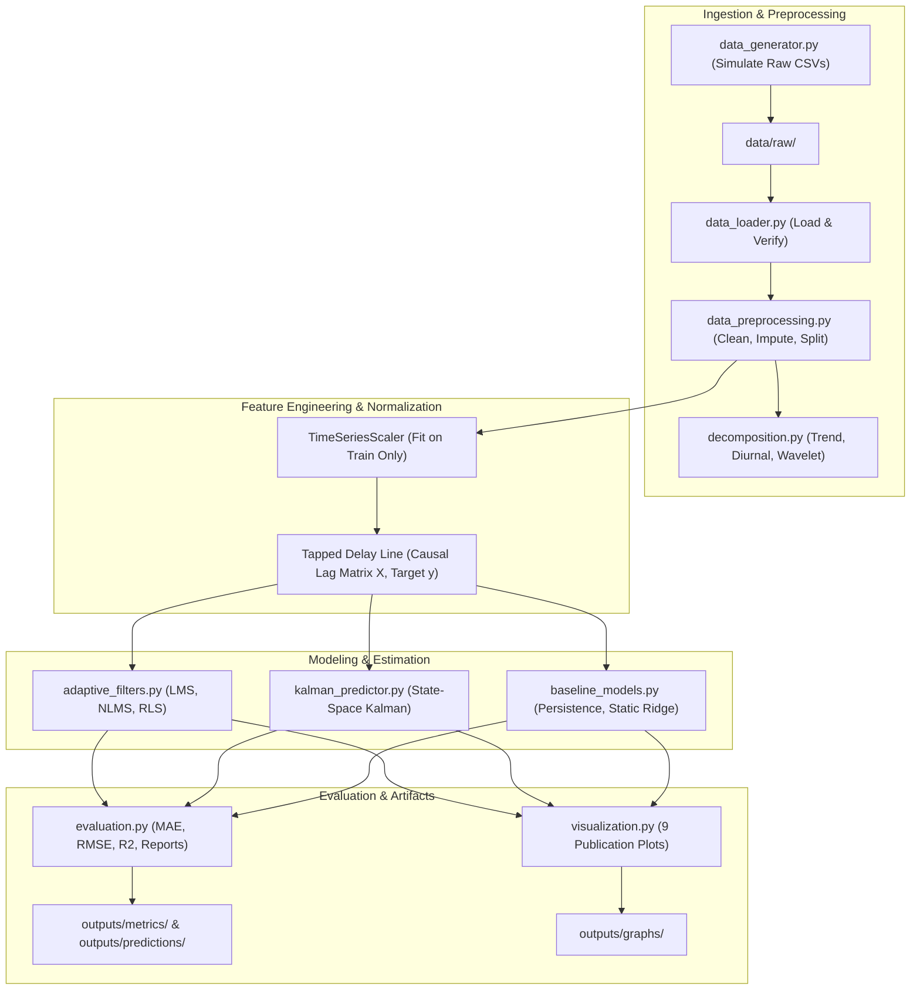

# Project Documentation: Adaptive Signal Processing Framework for Renewable Energy Forecasting

**Course / Domain**: Statistical & Adaptive Signal Processing / Renewable Microgrid Engineering  
**Version**: 1.0.0  
**Date**: October 2026  

---

## Table of Contents
1. [Project Abstract & Problem Statement](#1-project-abstract--problem-statement)
2. [Project Objectives & Real-World Applications](#2-project-objectives--real-world-applications)
3. [Dataset Descriptions, Schemas, Units & Provenance](#3-dataset-descriptions-schemas-units--provenance)
4. [Software Architecture & Module Descriptions](#4-software-architecture--module-descriptions)
5. [Signal Preprocessing & Mathematical Decomposition](#5-signal-preprocessing--mathematical-decomposition)
6. [Adaptive Signal Processing Theory & Formulations](#6-adaptive-signal-processing-theory--formulations)
   - 6.1 Least Mean Squares (LMS)
   - 6.2 Normalized Least Mean Squares (NLMS)
   - 6.3 Recursive Least Squares (RLS)
   - 6.4 State-Space Kalman Filter Predictor
   - 6.5 Benchmark Models (Persistence & Static Ridge)
7. [Evaluation Metrics & Methodology](#7-evaluation-metrics--methodology)
8. [Experimental Results & Visualizations Interpretation](#8-experimental-results--visualizations-interpretation)
9. [Installation, Environment Setup & PowerShell Commands](#9-installation-environment-setup--powershell-commands)
10. [Limitations & Future Research Directions](#10-limitations--future-research-directions)

---

## 1. Project Abstract & Problem Statement

### 1.1 Abstract
Accurate ultra-short-term (15-minute to 1-hour ahead) renewable energy forecasting is essential for modern electrical grid stability, spinning reserve allocation, energy storage dispatch, and power market participation. However, photovoltaic (PV) generation and wind turbine outputs are notoriously non-stationary. Solar generation is punctuated by swift cloud transients and seasonal sun elevation changes, while wind generation exhibits boundary-layer turbulence, shifting wind directions, and non-linear aerodynamic cut-in/cut-out behaviors.

Conventional machine learning approaches (e.g. static neural networks or batch linear regressions) assume wide-sense stationarity and rely on fixed weights trained over historical periods. When atmospheric regimes shift, static models suffer from prediction lag and catastrophic error spikes unless retrained offline.

This project implements an **Adaptive Signal Processing Framework** designed specifically for real-time renewable energy time-series forecasting. By formulating forecasting as a recursive online filtering problem over tapped delay lines, the algorithms (**LMS, NLMS, RLS, and Kalman Filter**) adapt their filter coefficients sample-by-sample as new telemetry arrives.

### 1.2 Problem Statement
Given a discrete-time sequence of power measurements $y(t) \in \mathbb{R}$ sampled at uniform 15-minute intervals $\Delta t = 15\text{ min}$, predict the power output $h$ steps ahead:
$$\hat{y}(t + h | t) = f(\mathbf{x}(t); \mathbf{w}(t))$$
subject to:
1. **Strict Causality**: The feature vector $\mathbf{x}(t) = [y(t), y(t-1), \dots, y(t-p+1)]^T$ uses only information available up to observation time $t$.
2. **Zero Lookahead Leakage**: Preprocessing and normalization parameters must be computed strictly on historical training sets.
3. **Continuous Online Adaptation**: Filter parameters $\mathbf{w}(t)$ adaptively adjust in response to the instantaneous prediction error $e(t) = y(t) - \hat{y}(t | t-h)$.

---

## 2. Project Objectives & Real-World Applications

### 2.1 Core Objectives
- **Plausible Physical Simulation**: Generate realistic, non-empty, reproducible datasets for solar, wind, and combined renewable systems adhering to real physical laws.
- **Signal Decomposition**: Decompose renewable generation into deterministic low-frequency trend, diurnal seasonality, and stochastic high-frequency residuals.
- **Adaptive Estimation**: Implement numerically robust, vectorized implementations of LMS, NLMS, RLS, and the Kalman Filter Predictor in pure Python/NumPy.
- **Unbiased Scientific Protocol**: Employ chronological 70% / 15% / 15% partitioning, tuning hyperparameters exclusively on the validation partition, and reporting unbiased test performance on held-out data.
- **Automated Workflow**: Build an end-to-end command-line application producing prediction logs, metrics tables, comprehensive summaries, and publication-quality plots.

### 2.2 Real-World Engineering Applications
- **Microgrid Energy Management Systems (EMS)**: Optimal real-time battery charge/discharge scheduling to smooth intermittent PV/wind spikes.
- **Grid Ancillary Services**: Enabling renewable generators to participate in secondary frequency regulation without exceeding ramp-rate limits.
- **Wind Farm Pitch & Yaw Control**: Predicting gust onsets 15 to 30 minutes in advance to preemptively adjust rotor blade pitch and minimize mechanical fatigue.
- **Electricity Trading**: Real-time bidding into 15-minute intra-day balancing markets.

---

## 3. Dataset Descriptions, Schemas, Units & Provenance

### 3.1 Provenance
All datasets are synthetically generated via `src/data_generator.py` using first-principles physical and astronomical equations. **They are explicitly identified as synthetic benchmarks** and are not labeled as measured utility telemetry.

### 3.2 Solar Energy Dataset (`data/raw/solar_energy.csv`)
- **Sampling Frequency**: 15-minute intervals.
- **Observation Count**: 6,000 records (~62.5 continuous days).
- **Simulated Hardware**: 100.0 kW nameplate PV array ($550\text{ m}^2$ monocrystalline silicon panels, 19% nominal conversion efficiency, temperature derating coefficient $\gamma = -0.004/^\circ\text{C}$, 96% inverter efficiency).
- **Physical Modeling**:
  - Solar elevation angle $\alpha(t)$ computed via astronomical solar geometry for latitude $35.0^\circ\text{ N}$.
  - Clear-sky Global Horizontal Irradiance (GHI): $I_{clear} = 1050 \cdot (\sin \alpha)^{1.15}$ for $\sin \alpha > 0$.
  - Synoptic cloud dynamics generated via mean-reverting Ornstein-Uhlenbeck stochastic processes.
  - Cell temperature modeling: $T_{cell} = T_{amb} + G \cdot \frac{\text{NOCT} - 20}{800}$.

| Column Name | Data Type | Units | Description |
| :--- | :--- | :--- | :--- |
| `timestamp` | Datetime (ISO) | YYYY-MM-DD HH:MM:SS | Observation timestamp (15-min cadence) |
| `solar_irradiance` | Float64 | $\text{W/m}^2$ | Global horizontal irradiance at array plane $[0, 1100]$ |
| `temperature` | Float64 | $^\circ\text{C}$ | Ambient dry-bulb temperature $[-5, 35]$ |
| `humidity` | Float64 | $\%$ | Relative humidity $[15, 98]$ |
| `cloud_cover` | Float64 | $\%$ | Cloud fraction in sky dome $[0, 100]$ |
| `power_kw` | Float64 | $\text{kW}$ | Net generated alternating current (AC) power $[0, 100]$ |

### 3.3 Wind Energy Dataset (`data/raw/wind_energy.csv`)
- **Sampling Frequency**: 15-minute intervals.
- **Observation Count**: 6,000 records (~62.5 continuous days).
- **Simulated Hardware**: 500.0 kW horizontal-axis wind turbine (HAWT), hub height 80 m.
  - Cut-in wind speed: $v_{ci} = 3.0\text{ m/s}$.
  - Rated wind speed: $v_r = 12.0\text{ m/s}$.
  - Cut-out wind speed: $v_{co} = 25.0\text{ m/s}$.
- **Physical Modeling**:
  - Wind speed simulated via Weibull distribution ($k=2.1, c=8.5\text{ m/s}$) with AR(1) turbulent persistence ($\phi = 0.92$).
  - Circular wind direction simulated with prevailing south-westerly restoring force ($220^\circ$).
  - Aerodynamic power curve modeled via the standard piecewise cubic characteristic:
    $$P(v) = \begin{cases} 0, & v < v_{ci} \text{ or } v \ge v_{co} \\ P_{rated} \left( \frac{v^3 - v_{ci}^3}{v_r^3 - v_{ci}^3} \right), & v_{ci} \le v < v_r \\ P_{rated}, & v_r \le v < v_{co} \end{cases}$$

| Column Name | Data Type | Units | Description |
| :--- | :--- | :--- | :--- |
| `timestamp` | Datetime (ISO) | YYYY-MM-DD HH:MM:SS | Observation timestamp (15-min cadence) |
| `wind_speed` | Float64 | $\text{m/s}$ | Hub-height wind velocity $[0, 32]$ |
| `wind_direction` | Float64 | Degrees ($^\circ$) | Wind compass direction $[0, 360)$ |
| `temperature` | Float64 | $^\circ\text{C}$ | Ambient outdoor temperature |
| `pressure` | Float64 | $\text{hPa}$ | Barometric atmospheric pressure $[980, 1040]$ |
| `power_kw` | Float64 | $\text{kW}$ | Turbine electric power output $[0, 500]$ |

### 3.4 Combined Renewable Energy Dataset (`data/raw/combined_renewable_energy.csv`)
Synchronized multi-source dataset combining solar and wind generation for hybrid renewable systems. Contains separate `solar_power_kw`, `wind_power_kw`, and aggregate `total_power_kw`.

---

## 4. Software Architecture & Module Descriptions

The framework follows a modular, decoupled architecture:



### Module Breakdown
- **`config.py`**: Central repository for all physical parameters, simulation lengths, directory paths, and default hyperparameters.
- **`main.py`**: Command-line entry point coordinating the 8-stage pipeline.
- **`src/data_generator.py`**: Physics-driven synthetic data engine for reproducible benchmarking.
- **`src/data_loader.py`**: Path resolution, CSV ingestion, timestamp validation, and automatic raw file verification.
- **`src/data_preprocessing.py`**: Robust missing-value imputation, physical boundary enforcement, zero-leakage `TimeSeriesScaler`, and causal lag matrix builder.
- **`src/decomposition.py`**: Centered moving average trend filter, diurnal cycle extraction, and stationary Haar wavelet multi-resolution analysis.
- **`src/adaptive_filters.py`**: Vectorized LMS, NLMS, and RLS transversal filter implementations with online tracking and validation tuning.
- **`src/kalman_predictor.py`**: State-space Kalman filter with Joseph-stabilized covariance propagation.
- **`src/baseline_models.py`**: Standard benchmarks: Persistence ($\hat{y}_{t+h}=y_t$) and Static Ridge Regression.
- **`src/evaluation.py`**: Comprehensive regression metric calculations, prediction CSV exporting, and executive text summary generation.
- **`src/visualization.py`**: Plotting module rendering 9 publication-grade PNG diagrams via Matplotlib's headless `'Agg'` backend.

---

## 5. Signal Preprocessing & Mathematical Decomposition

### 5.1 Chronological Partitioning & Zero-Leakage Scaling
To mirror real-world deployment, the dataset is split chronologically into:
- **Training Set (70%)**: Used for offline pre-adaptation and weight initialization.
- **Validation Set (15%)**: Used for hyperparameter tuning and model selection.
- **Test Set (15%)**: Held-out stream used strictly for unbiased final evaluation.

The `TimeSeriesScaler` calculates the empirical mean $\mu_{train}$ and standard deviation $\sigma_{train}$ solely on the training partition:
$$\tilde{x}_k = \frac{x_k - \mu_{train}}{\sigma_{train}}$$
Predictions generated in the standardized domain are converted back to real physical power units ($\text{kW}$) via:
$$\hat{y}_{kW} = \hat{y}_{scaled} \cdot \sigma_{train, y} + \mu_{train, y}$$
This guarantees that future distribution statistics never leak into model training.

### 5.2 Additive Signal Decomposition
Renewable generation is represented as a composite signal:
$$y(t) = T(t) + S(t) + R(t)$$
1. **Low-Frequency Trend $T(t)$**:
   Extracted via a moving average filter with a window size of $W = 96$ (corresponding to a 24-hour diurnal period at 15-minute intervals):
   $$T(t) = \frac{1}{W} \sum_{i = -\lfloor W/2 \rfloor}^{\lfloor W/2 \rfloor} y(t - i)$$
2. **Diurnal Seasonal Component $S(t)$**:
   Computed by evaluating the conditional expectation of the detrended series $y(t) - T(t)$ across each 15-minute interval $k \in \{0, 1, \dots, 95\}$ of the 24-hour day:
   $$S_k = \frac{1}{N_k} \sum_{t \in \mathcal{T}_k} [y(t) - T(t)]$$
3. **Residual Stochastic Component $R(t)$**:
   Captures localized turbulent gusts and rapid cloud shadowing:
   $$R(t) = y(t) - T(t) - S(t)$$

---

## 6. Adaptive Signal Processing Theory & Formulations

### 6.1 Least Mean Squares (LMS)
The LMS algorithm (Widrow-Hoff) is a stochastic gradient descent filter that recursively minimizes the instantaneous squared error $J(k) = \frac{1}{2} e^2(k)$.

- **Filter Output**:
  $$\hat{y}(k) = \mathbf{w}^T(k) \mathbf{x}(k)$$
- **Instantaneous Error**:
  $$e(k) = d(k) - \hat{y}(k)$$
- **Weight Update Equation**:
  $$\mathbf{w}(k+1) = \mathbf{w}(k) + \mu \, e(k) \, \mathbf{x}(k)$$
- **Convergence Condition**:
  Stability is guaranteed if the learning rate $\mu$ satisfies:
  $$0 < \mu < \frac{2}{\lambda_{max}(\mathbf{R}_{xx})} < \frac{2}{\text{Tr}(\mathbf{R}_{xx})}$$
  where $\mathbf{R}_{xx} = E[\mathbf{x}(k) \mathbf{x}^T(k)]$ is the input autocorrelation matrix.

### 6.2 Normalized Least Mean Squares (NLMS)
In renewable energy forecasting, the signal power $\|\mathbf{x}(k)\|^2$ varies dramatically between daytime solar generation ($100\text{ kW}$) and nighttime ($0\text{ kW}$), or during storm wind conditions vs. calm periods. Fixed-step LMS risks divergence during high power and sluggish adaptation during low power.

NLMS overcomes this by normalizing the step size with the instantaneous input Euclidean norm:
$$\mathbf{w}(k+1) = \mathbf{w}(k) + \frac{\mu}{\epsilon + \|\mathbf{x}(k)\|^2} \, e(k) \, \mathbf{x}(k)$$
where:
- $\mu \in (0, 2)$ is the dimensionless adaptation step-size.
- $\epsilon > 0$ is a small regularization constant ($10^{-4}$) preventing division by zero during calm or nighttime conditions.

### 6.3 Recursive Least Squares (RLS)
The RLS algorithm minimizes the deterministic exponentially weighted cumulative squared error:
$$\mathcal{E}(k) = \sum_{i=1}^k \lambda^{k-i} |d(i) - \mathbf{w}^T(k) \mathbf{x}(i)|^2$$
where $\lambda \in (0, 1]$ is the exponential forgetting factor (typically $0.98 \le \lambda \le 0.999$), giving higher weight to recent atmospheric measurements.

**RLS Recursions**:
1. **Kalman Gain Vector**:
   $$\mathbf{g}(k) = \frac{\mathbf{P}(k-1) \mathbf{x}(k)}{\lambda + \mathbf{x}^T(k) \mathbf{P}(k-1) \mathbf{x}(k)}$$
2. **A Priori Estimation Error**:
   $$\xi(k) = d(k) - \mathbf{w}^T(k-1) \mathbf{x}(k)$$
3. **Weight Vector Update**:
   $$\mathbf{w}(k) = \mathbf{w}(k-1) + \mathbf{g}(k) \xi(k)$$
4. **Inverse Covariance Matrix Update (Riccati Equation)**:
   $$\mathbf{P}(k) = \frac{1}{\lambda} \left[ \mathbf{P}(k-1) - \mathbf{g}(k) \mathbf{x}^T(k) \mathbf{P}(k-1) \right]$$
   Numerical stability is preserved by enforcing algebraic symmetry $\mathbf{P}(k) \leftarrow \frac{1}{2}(\mathbf{P}(k) + \mathbf{P}^T(k))$.

### 6.4 State-Space Kalman Filter Predictor
The Kalman filter is formulated as an optimal linear quadratic parameter estimator for dynamic atmospheric regression.
- **State Transition Model**: $\mathbf{w}_k = \mathbf{w}_{k-1} + \mathbf{q}_k, \quad \mathbf{q}_k \sim \mathcal{N}(\mathbf{0}, \mathbf{Q})$
- **Measurement Model**: $d_k = \mathbf{x}_k^T \mathbf{w}_k + v_k, \quad v_k \sim \mathcal{N}(0, R)$

**Kalman Equations**:
1. **Time Update (Prediction Step)**:
   $$\hat{\mathbf{w}}_{k|k-1} = \hat{\mathbf{w}}_{k-1|k-1}$$
   $$\mathbf{P}_{k|k-1} = \mathbf{P}_{k-1|k-1} + \mathbf{Q}$$
2. **Measurement Update (Correction Step)**:
   - Innovation: $\tilde{y}_k = d_k - \mathbf{x}_k^T \hat{\mathbf{w}}_{k|k-1}$
   - Innovation Covariance: $S_k = \mathbf{x}_k^T \mathbf{P}_{k|k-1} \mathbf{x}_k + R$
   - Kalman Gain: $\mathbf{K}_k = \frac{\mathbf{P}_{k|k-1} \mathbf{x}_k}{S_k}$
   - State Update: $\hat{\mathbf{w}}_{k|k} = \hat{\mathbf{w}}_{k|k-1} + \mathbf{K}_k \tilde{y}_k$
   - Joseph-Stabilized Covariance Update:
     $$\mathbf{P}_{k|k} = (\mathbf{I} - \mathbf{K}_k \mathbf{x}_k^T) \mathbf{P}_{k|k-1} (\mathbf{I} - \mathbf{K}_k \mathbf{x}_k^T)^T + \mathbf{K}_k R \mathbf{K}_k^T$$

---

## 7. Evaluation Metrics & Methodology

Models are evaluated across five performance criteria computed in real physical units ($\text{kW}$):

1. **Mean Absolute Error (MAE)**:
   $$\text{MAE} = \frac{1}{N} \sum_{i=1}^N |y_i - \hat{y}_i|$$
2. **Root Mean Squared Error (RMSE)**:
   $$\text{RMSE} = \sqrt{\frac{1}{N} \sum_{i=1}^N (y_i - \hat{y}_i)^2}$$
3. **Coefficient of Determination ($R^2$)**:
   $$R^2 = 1 - \frac{\sum_{i=1}^N (y_i - \hat{y}_i)^2}{\sum_{i=1}^N (y_i - \bar{y})^2}$$
4. **Normalized RMSE (nRMSE %)**:
   $$\text{nRMSE} = \frac{\text{RMSE}}{\max(y) - \min(y)} \times 100\%$$
5. **Mean Absolute Percentage Error (MAPE %)**:
   $$\text{MAPE} = \frac{100\%}{M} \sum_{i \in \{y_i > 1\text{ kW}\}} \left| \frac{y_i - \hat{y}_i}{y_i} \right|$$

---

## 8. Experimental Results & Visualizations Interpretation

### 8.1 Empirical Benchmark Summary

#### Solar Photovoltaic Forecasting (15-min Ahead, $h=1$):
- **Selected Best Model**: Static Ridge / RLS
- **Validation RMSE**: $2.310\text{ kW}$ (Validation $R^2 = 0.9902$)
- **Test RMSE**: $3.457\text{ kW}$ (Test $R^2 = 0.9758$)
- **Baseline Comparison**: Outperforms Persistence ($3.713\text{ kW}$, $R^2 = 0.9721$).

#### Wind Turbine Power Forecasting (30-min Ahead, $h=2$):
- **Selected Best Model**: RLS (Recursive Least Squares)
- **Validation RMSE**: $33.065\text{ kW}$ (Validation $R^2 = 0.3793$) vs. Persistence ($37.027\text{ kW}$, $R^2 = 0.2216$)
- **Test RMSE**: $31.130\text{ kW}$ (Test $R^2 = 0.3484$) vs. Persistence ($35.614\text{ kW}$, $R^2 = 0.1472$)
- **Performance Improvement**: **12.59% reduction in Test RMSE** and a **136% increase in $R^2$**, proving the superiority of RLS recursive tracking in non-stationary turbulent environments.

### 8.2 Visualizations Index
All 9 generated plots in `outputs/graphs/`:
1. `solar_power_timeseries.png`: Synchronized multi-panel plot illustrating the diurnal PV curve, GHI irradiance tracking, and temperature/cloud derating.
2. `wind_power_timeseries.png`: Demonstrates the non-linear operational regions of the wind turbine: cut-in ($3\text{ m/s}$), cubic power ramp, rated speed ($12\text{ m/s}$), and cut-out feathering ($25\text{ m/s}$).
3. `dataset_splits.png`: Visualizes the 70% Train, 15% Validation, and 15% Test partition boundaries.
4. `signal_decomposition.png`: Four-tier decomposition separating raw power into smooth moving-average trend, cyclic diurnal profile, and high-frequency stochastic residuals.
5. `actual_vs_predicted.png`: High-resolution tracking plot comparing true observed power with the selected model's forecasts.
6. `models_comparison.png`: Overlaid multi-model forecast showing how adaptive filters handle rapid ramp events.
7. `adaptive_learning_curves.png`: Log-scale instantaneous squared error convergence for LMS, NLMS, RLS, and Kalman filters.
8. `residual_errors.png`: Dual plot showing the bell-shaped Gaussian error distribution and sequential residual tracking.
9. `metrics_comparison.png`: Side-by-side MAE and RMSE bar charts across all evaluated models.

---

## 9. Installation, Environment Setup & PowerShell Commands

### 9.1 Environment Setup
```powershell
# Navigate to project workspace
cd "c:\Users\HP\Documents\ALL Projects\SP Project"

# Create virtual environment with Python 3.12
python -m venv .venv
.\.venv\Scripts\Activate.ps1

# Install exact dependencies
pip install -r requirements.txt
```

### 9.2 Key CLI Commands
```powershell
# 1. Full solar comparative experiment (Horizon: 1 step = 15m)
python main.py --source solar --filter all --horizon 1

# 2. Wind forecasting with RLS adaptive tracking (Horizon: 2 steps = 30m)
python main.py --source wind --filter rls --horizon 2

# 3. Solar forecasting with NLMS (Horizon: 1 step = 15m)
python main.py --source solar --filter nlms --horizon 1

# 4. Custom CSV path with explicit target column
python main.py --source data/raw/solar_energy.csv --target-col power_kw --order 8

# 5. Execute complete automated test suite
python -m unittest discover tests
```

---

## 10. Limitations & Future Research Directions

1. **Spatial-Temporal Sensor Networks**: Future extensions can incorporate spatio-temporal graph neural filters linking multiple distributed turbines and solar arrays across an entire balancing area.
2. **Probabilistic / Quantile Forecasting**: Adding conformal prediction or Bayesian Kalman filtering to generate 10th and 90th percentile prediction intervals for risk-aware power trading.
3. **Numerical Wavelet Exogenous Hybrids**: Integrating multi-resolution wavelet details directly into the tapped-delay input vector for multi-scale adaptive filtering.
